# ShopList

Multi-tenant inventory and order management for small businesses, built to run on the Cloudflare Workers **free plan**.
Each business gets its own isolated database, three clear levels of access, and a console for the platform owner.

**Live:** https://shoplist-v2.technology1.workers.dev

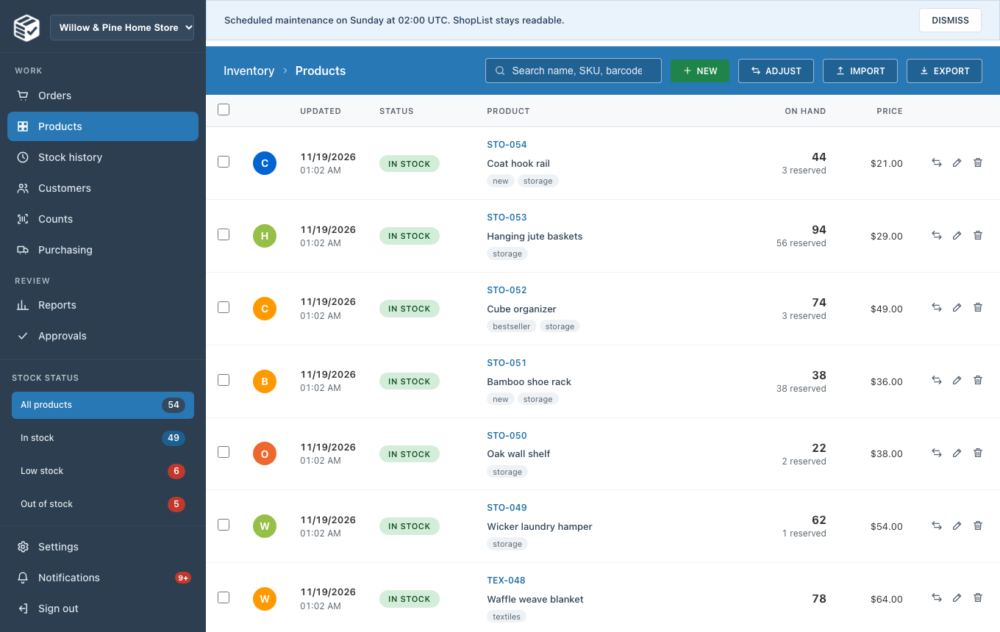

## What it does

| Area | What you get |
|---|---|
| **Inventory** | Products with SKUs, barcodes, tags, cost and price, reorder points, per-product tax. Stock per location, an append-only ledger, adjust, transfer and receive. Optimistic concurrency and idempotency, so two people cannot overwrite each other. |
| **Orders** | Orders from any channel (Shopify, Amazon, eBay, WooCommerce, phone, manual) with stock reservations, "waiting for stock", mark paid, ship, cancel, printable invoices, and a customer status link. |
| **Purchasing** | Suppliers, purchase orders (draft, sent, partly received, received), receiving up to 10% over, reorder suggestions from sales speed, and a supplier link to confirm or dispatch. |
| **Counts and approvals** | Blind stock counts with variances, and approval rules (large adjustments, damage, count variance, cancelling paid orders, price drops). |
| **Reports** | Sales by day and by product, valuation, movements, low and dead stock, shrinkage, staff activity. CSV export. |
| **Team** | Admin, manager, sales, stock keeper, accountant and viewer roles, invitations by email, per-location scope. |
| **Integrations** | API keys with scopes, signed webhooks with retries and a delivery log, CSV import and export, generated API docs at `/api/docs`. |
| **Safety** | Nightly backups with restore, activity log export, scheduled deletion (14 days, cancellable), plan limits. |

## Three levels of access

1. **Owner (platform developer).** One super admin, never a member of any business. Signs in with GitHub at `/owner`, and runs the platform from a console: businesses, people, security alerts, system status, business health, notices, support.
2. **Business admin.** Runs one business: team, settings, plan, API keys, support access, backups.
3. **Staff.** Manager, sales, stock keeper, accountant or viewer. Each sees and does only what the job needs.

The owner can only enter a business through a **support window**, and only with its admin's consent: read-only by default, changes only with an explicit tick, never a delete, always recorded on both sides. See [docs/SECURITY.md](docs/SECURITY.md).

## Screenshots

All screens below come from the seeded demo business (see [docs/DEMO.md](docs/DEMO.md)).

| | |
|---|---|
| 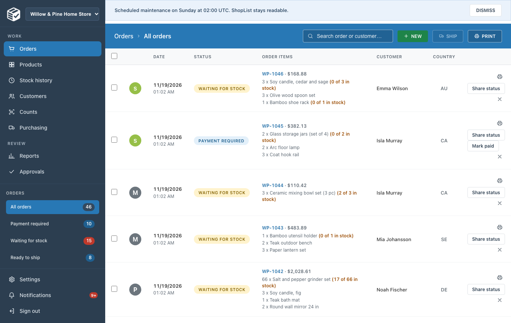 | 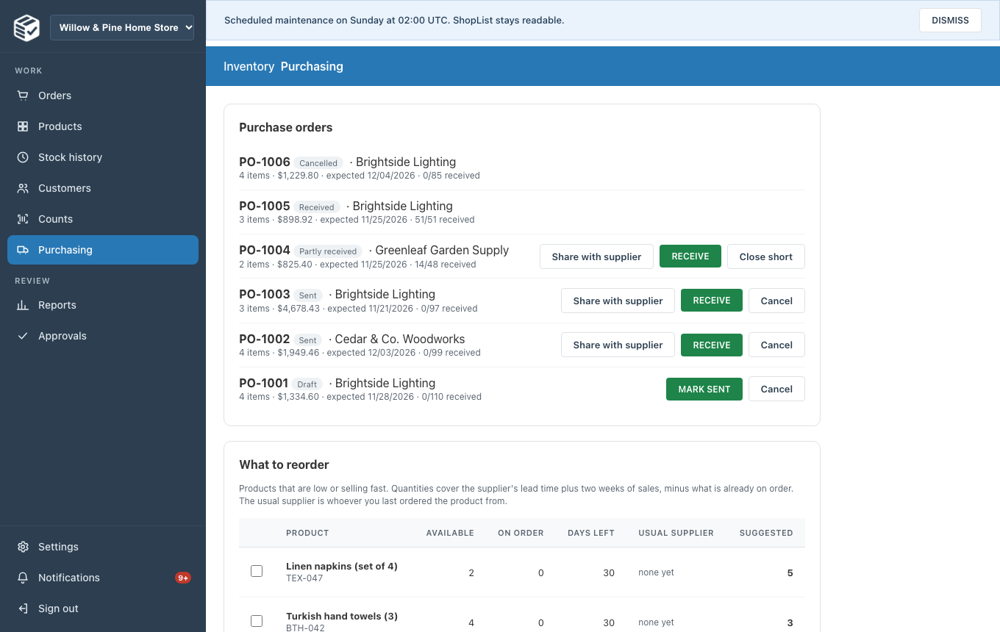 |
| **Orders** with stock reservations and live counts | **Purchasing**: purchase orders and what to reorder |
| 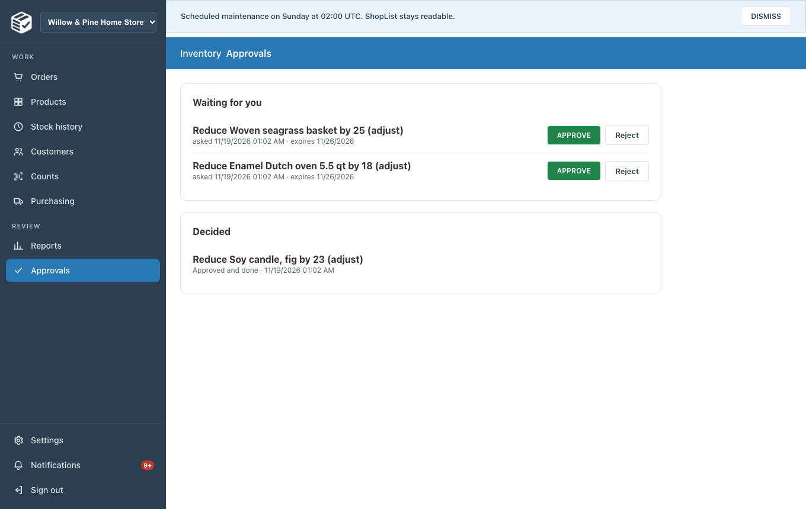 | 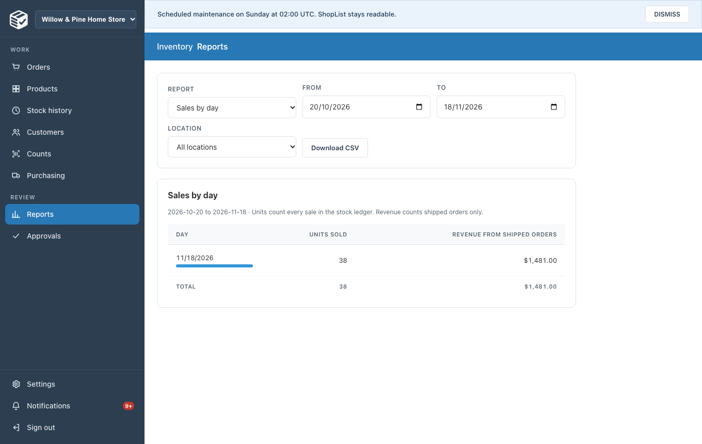 |
| **Approvals** for risky stock changes | **Reports** with CSV export |
| 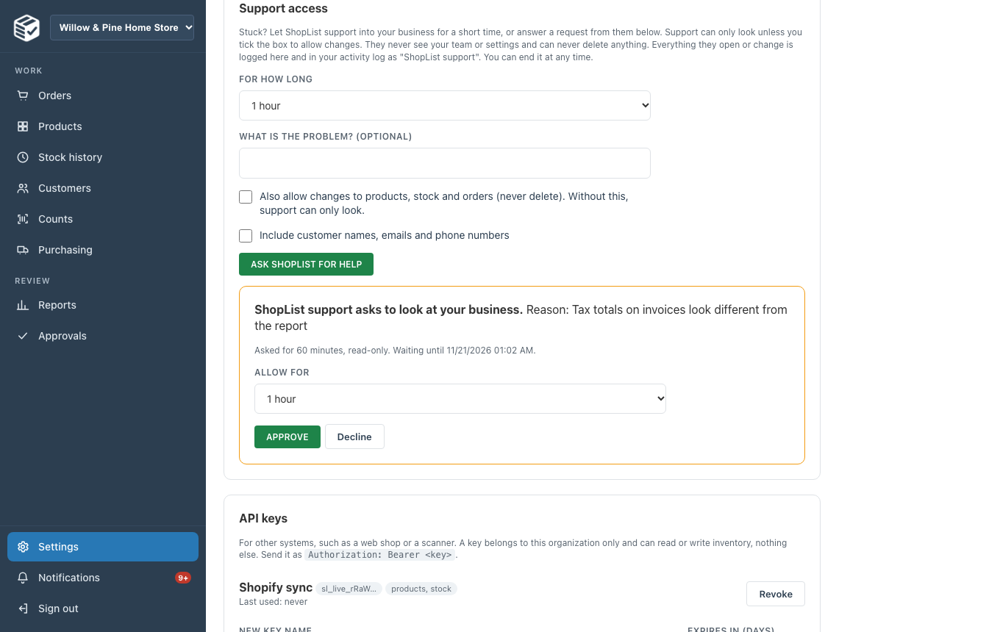 | 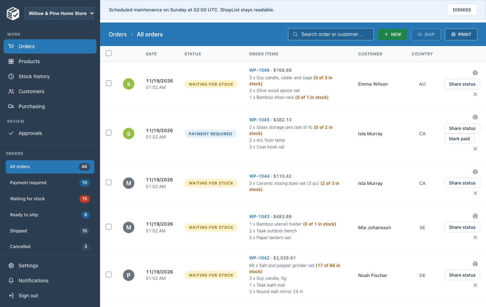 |
| **Support access**: the admin answers a request from ShopList support | A **sales** teammate sees only what the role allows |

### The owner console

| | |
|---|---|
| 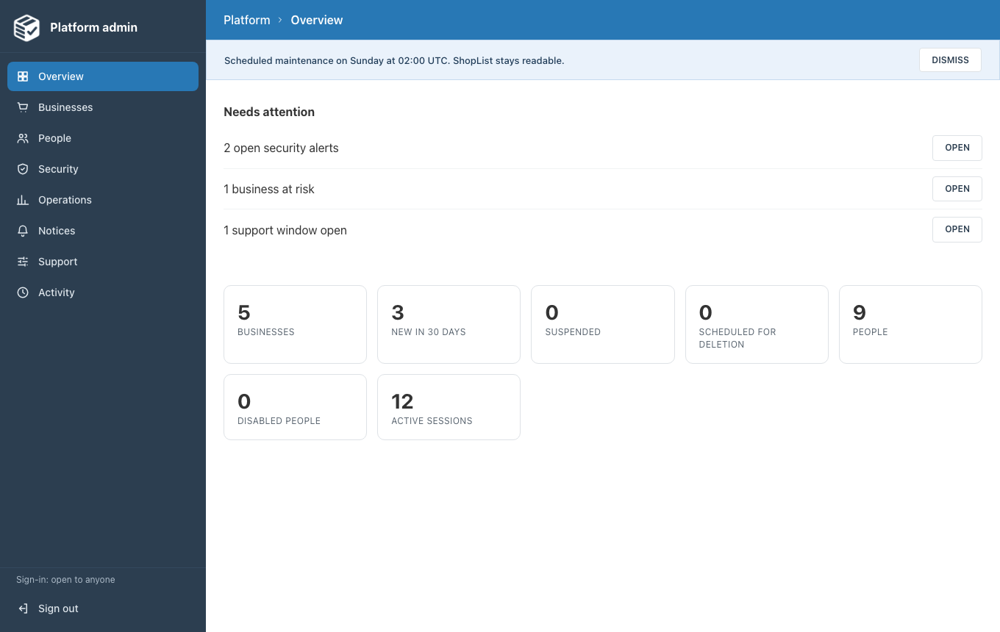 | 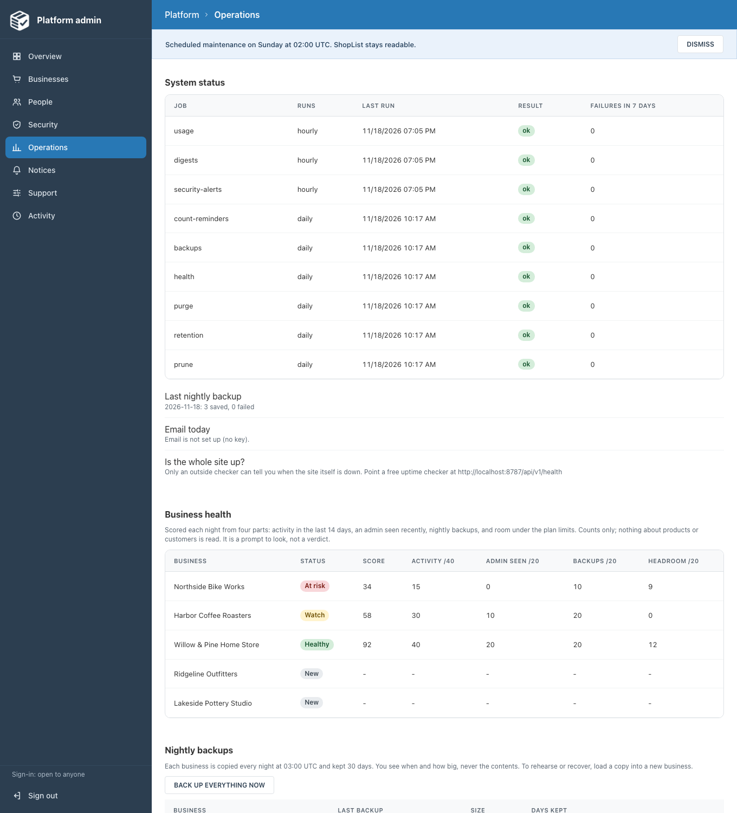 |
| **Overview** with a "needs attention" list | **Operations**: job status, business health, backups |
| 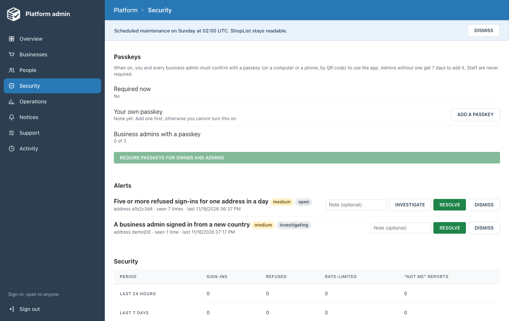 | 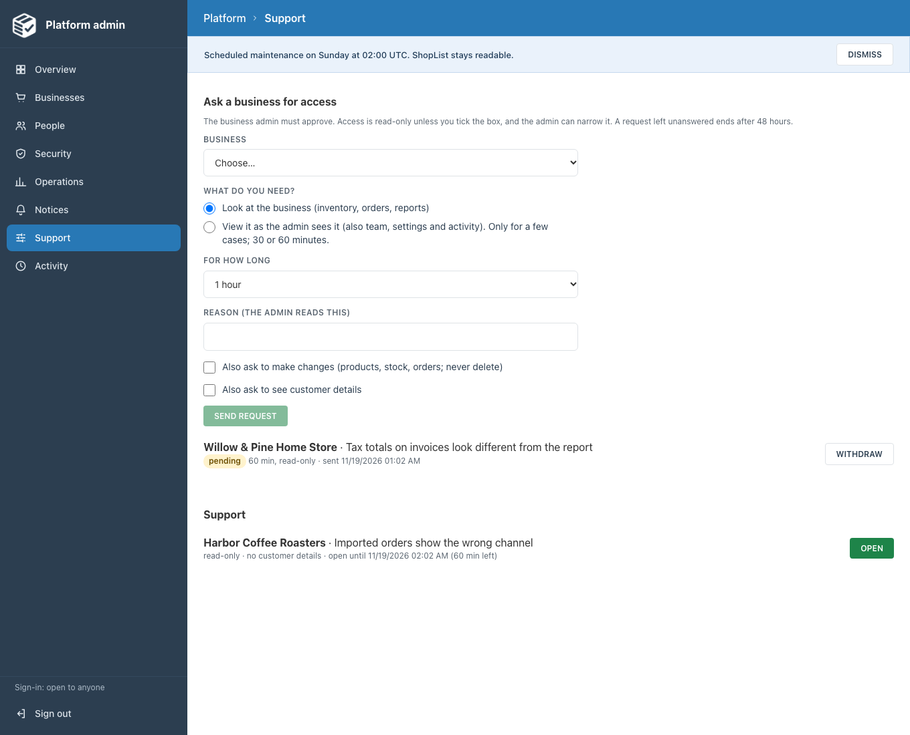 |
| **Security alerts** with states and notes | **Support**: ask a business for access, open windows |

### Sign in

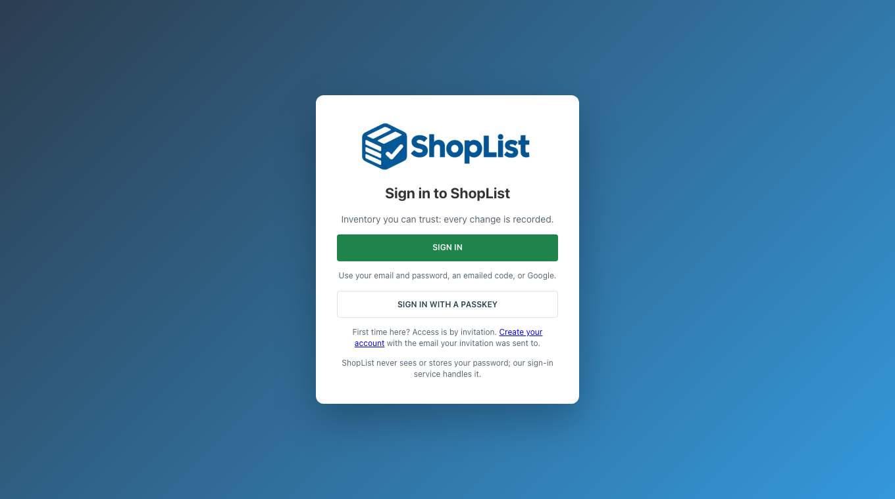

Email and password, an emailed code, Google, or a passkey (on this device, or on a phone by scanning a QR code). Access is by invitation only.

## How it is built

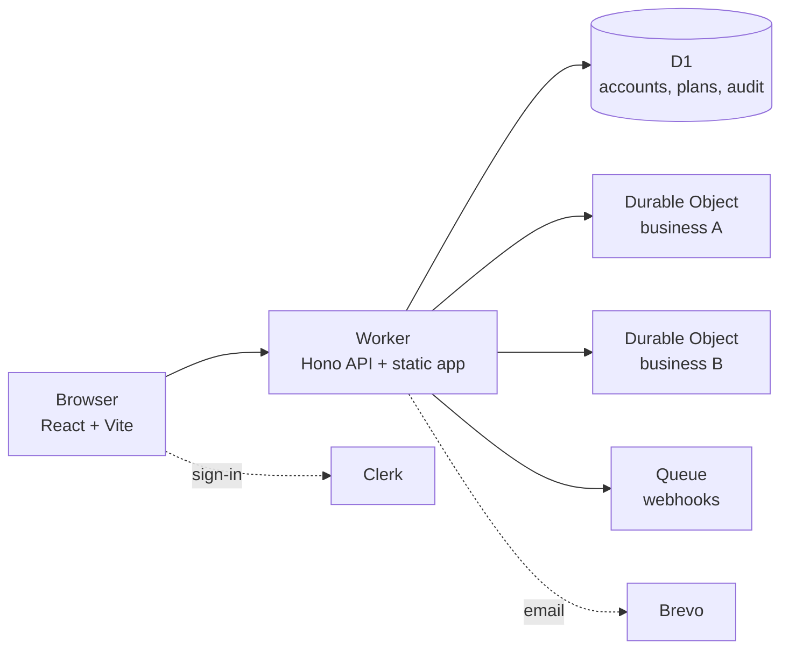

- **One Durable Object (SQLite) per business** holds its products, stock, orders and activity log. Businesses never share a database, so one cannot read another's data even if application code has a bug.
- **D1** holds the control plane: users, memberships, sessions, plans, invitations, alerts and platform audit.
- **Zod schemas shared** between the API and the web app, so the contract is one source of truth.
- **No passwords stored by ShopList.** Sign-in runs through Clerk (customers) and GitHub (the owner); passkeys are verified in the Worker with WebCrypto only.
- **Hourly job** sends morning summaries, checks usage, and at 03:00 UTC takes backups, scores business health and tidies old records.

More in [docs/ARCHITECTURE.md](docs/ARCHITECTURE.md).

## Run it locally

```bash
npm install --legacy-peer-deps
npm run build -w @shoplist/web                       # the Worker serves the built app
npx wrangler d1 migrations apply shoplist-control --local --config apps/api/wrangler.jsonc
npm run dev -w @shoplist/api -- --var DEV_AUTH:true --var INSECURE_DEV_COOKIES:true --var SIGNIN_MODE:open
# open http://localhost:8787, and in a second terminal fill it with a believable shop:
node apps/api/scripts/seed-demo.mjs
```

The development flags go on the command line, not in a `.dev.vars` file, because the test runner reads that file too and would change behaviour. `DEV_AUTH` turns on a development-only sign-in that does not exist in production. The seed script prints the demo accounts; see [docs/DEMO.md](docs/DEMO.md).

```bash
npm test               # 361 tests, in the real Workers runtime
npm run typecheck
```

## Documentation

| Read | For |
|---|---|
| [docs/README.md](docs/README.md) | Index of everything below |
| [docs/DEMO.md](docs/DEMO.md) | Demo data, test accounts, regenerating the screenshots |
| [docs/ARCHITECTURE.md](docs/ARCHITECTURE.md) | How the system fits together |
| [docs/DATA_MODEL.md](docs/DATA_MODEL.md) | Every table and invariant |
| [docs/API.md](docs/API.md) | The HTTP contract (also live at `/api/docs`) |
| [docs/SECURITY.md](docs/SECURITY.md) | Threat model, sign-in, access, support windows, passkeys |
| [docs/OPERATIONS.md](docs/OPERATIONS.md) | Deploying, jobs, backups, runbooks |
| [docs/HANDOFF.md](docs/HANDOFF.md) | The few things only the owner can do |
| [docs/ROADMAP.md](docs/ROADMAP.md) | What is built and what is open |
| [docs/PLAN.md](docs/PLAN.md) | The full feature plan in one file |

## Status

Built and deployed; 361 tests pass and CI is green. Open items need the owner: moving sign-in to a production Clerk instance (needs a domain), enabling R2 and Analytics Engine, and a real phone and screen-reader check. See [docs/ROADMAP.md](docs/ROADMAP.md) and [docs/HANDOFF.md](docs/HANDOFF.md).

License: MIT.
