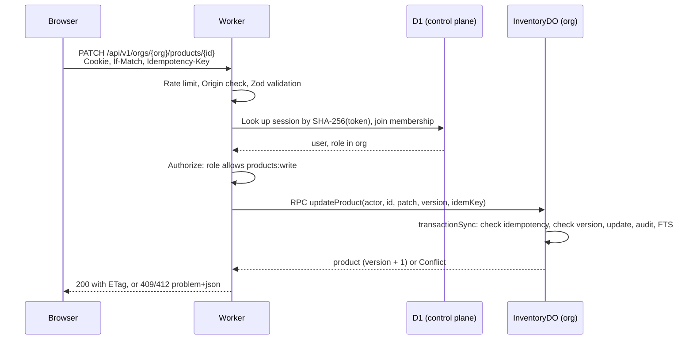

# Architecture

## 1. Context

ShopList lets a small or medium business track what it sells, how many units are at each location, and every change to those numbers. Users work in a browser or on a phone. Other systems (a web shop, a point-of-sale app) integrate through the API.

```mermaid
flowchart LR
  U[Browser / PWA] -->|HTTPS| W
  S[External systems<br/>API keys, webhooks] -->|HTTPS| W
  subgraph Cloudflare
    W[Worker<br/>static assets + /api/v1]
    W --> CP[(D1: control plane<br/>users, orgs, sessions)]
    W --> DO1[(Durable Object<br/>org A inventory)]
    W --> DO2[(Durable Object<br/>org B inventory)]
    W --> Q[[Queues]]
    Q --> C[Consumer Worker<br/>imports, alerts, webhooks]
    C --> DO1
    C --> R2[(R2: exports, backups)]
    W --> T[Turnstile]
  end
  W -->|OAuth| IDP[GitHub / Google]
```

## 2. Components

| Component | Technology | Responsibility |
|---|---|---|
| Web app | React 19, TypeScript, Vite, React Router, TanStack Query; plain CSS that extends the original orders-dashboard stylesheet | All UI. Served as static assets from the Worker. |
| API Worker | Hono, Zod, `@hono/zod-openapi` | Routing, validation, authentication, authorization, request shaping. Stateless. |
| Control plane | D1 (one database) | Users, OAuth links, passkeys, sessions, organizations, memberships, invitations, API keys. |
| Data plane | One SQLite-backed Durable Object per organization (`InventoryDO`) | Products, locations, stock levels, ledger, reservations, audit log, full-text index, idempotency records. |
| Async jobs | Queues + consumer Worker | CSV import and export, low-stock alerts, outbound webhooks, nightly backups. |
| Blob storage | R2 | Export files, product images, nightly backups. |
| Bot protection | Turnstile | Sign-in, sign-up and invitation acceptance. |
| Scheduling | Cron Triggers | Nightly backup, expiring reservations, cleaning old idempotency keys and sessions. |

There is **one deployable Worker** for the API and app, plus one consumer Worker. Splitting further adds latency and operational cost without a benefit at this scale.

## 3. Why a Durable Object per organization

This is the central decision. The alternatives considered:

| Option | Tenant isolation | Write scaling | Free tier | Verdict |
|---|---|---|---|---|
| A. One D1 database, `org_id` column on every row | By convention: one missed `WHERE` leaks data | All tenants share one writer | Yes | Rejected: isolation depends on every query being correct, and one busy tenant slows everyone. |
| B. One D1 database per org | Physical | Per tenant | **No**: Free allows 10 databases | Rejected for the free tier. Viable on Workers Paid (100,000 databases). |
| C. Postgres (Neon) via Hyperdrive | Row-level security | One primary | Partly: external free tier, extra moving parts | Rejected: adds a second vendor and network hop. Reconsider if cross-tenant SQL reporting becomes core. |
| **D. Durable Object (SQLite) per org** | **Physical** | **Per tenant, horizontal** | **Yes** | **Chosen.** |

What option D gives us:

- **Isolation by construction.** The Worker resolves the org from the session's membership, then calls `env.INVENTORY.idFromName(orgId)`. Code inside the object can only see its own SQLite file.
- **A free, correct write lock.** A Durable Object processes one request at a time, and `ctx.storage.transactionSync()` makes a group of statements atomic. Stock changes cannot race.
- **Horizontal scale.** Adding tenants adds objects. There is no shared bottleneck on the data path.
- **Low latency.** The object lives near where it was first used, and its SQLite storage is local to it.

Costs and how they are handled:

| Cost | Mitigation |
|---|---|
| A single very busy org is limited by one object's throughput (roughly hundreds to low thousands of simple requests per second) | Shard by location: `idFromName(orgId + ":" + locationId)` for stock, with a catalog object for products. Only needed when an org outgrows one object; see §6. |
| No SQL across tenants | Cross-tenant metrics go to Analytics Engine through the Queue. Product features never need cross-tenant queries. |
| Per-object storage cap (1 GB on Free, 10 GB on Paid; confirm current values in Cloudflare's docs) | Roughly 1 to 2 million products with history per org on Free. Ledger rows older than 24 months are archived to R2. |
| Schema migrations run per object | Each object stores its schema version and migrates itself on first request after a deploy. See [DATA_MODEL.md § Migrations](DATA_MODEL.md#migrations). |

## 4. Request lifecycle

- Authentication and authorization happen in the Worker. The Durable Object trusts only the `actor` the Worker passes it and never receives raw client input without validation.
- The Worker talks to the Durable Object through **RPC methods**, not HTTP, so calls are typed end to end.
- One user action is one Worker request plus at most one Durable Object call. That keeps it inside the free plan's CPU and subrequest limits.

## 5. Consistency model

| Data | Guarantee |
|---|---|
| Stock levels, products, reservations | Strongly consistent and serialized per org (single Durable Object, transactional). |
| Ledger | Append-only. `on_hand` always equals the sum of movements for that product and location; a nightly job verifies this. |
| Sessions and memberships | Strongly consistent (D1 primary). A removed member loses access on their next request. |
| Search index (FTS5) | Updated in the same transaction as the product, so search is never stale. |
| Webhooks, alerts, analytics | At least once, asynchronous. Receivers must deduplicate by `event.id`. |

## 6. Scaling plan

Each level is triggered by a measured signal, not by anticipation.

| Level | Trigger | Change |
|---|---|---|
| 0. Launch | — | Everything in this document. Fits the free plan for roughly 15,000 to 20,000 inventory changes and about 90,000 API calls per day. |
| 1. Leave the free plan | Any daily free allowance passes 70% on three days in a week | Move to Workers Paid (USD 5/month). No code changes. CPU limit rises, daily caps become monthly included usage. |
| 2. Hot tenant | One org's object shows sustained queueing or p95 latency over 200 ms | Split that org's stock by location into separate objects. The catalog stays in one object. Routing is a lookup table in the control plane. |
| 3. Read-heavy integrations | An org's reads exceed about 20x its writes, mostly from API keys | Cache list and lookup responses at the edge for 5 to 30 seconds, keyed by org and the object's change counter. |
| 4. Control plane load | D1 reads approach limits, mostly session lookups | Cache session lookups in the Worker for 60 seconds per isolate, and turn on D1 read replication. Revocation stays immediate because logout also deletes the cached entry by key. |
| 5. Analytics | Users want reports across long periods | Stream ledger events to Analytics Engine or R2 (Parquet) and query there. Never run reports on the transactional object. |

## 7. Technology choices

| Choice | Reason | Rejected alternative |
|---|---|---|
| Hono | Small, Workers-native, typed routing and middleware | Express: not built for Workers. Itty-router: less ecosystem. |
| Zod + OpenAPI generation | One schema validates requests and produces the API docs and typed client | Hand-written OpenAPI: drifts from the code. |
| React + React Router + TanStack Query | Caching, invalidation, infinite lists and retries are solved problems | Vanilla JS (v1): every one of those would be hand-written. |
| Plain CSS on the original dashboard stylesheet | Keeps the existing look exactly, no new styling dependency, about 4 KB gzipped of CSS | Tailwind or a component kit: would restyle the dashboard the owner wants kept. |
| Own small `Modal` with focus trap | Dialogs are the only complex widget; ~50 lines covers Escape, focus return and Tab trapping | Radix primitives: reconsider if more complex widgets (menus, comboboxes) appear. |
| OAuth + passkeys, no passwords | Workers caps PBKDF2 at 100,000 iterations (below OWASP's 600,000) and the free plan allows 10 ms CPU per request, so strong password hashing is not available. No passwords also means none to leak. | Email and password: weak hashing on this platform. Magic links: needs a paid email service. |
| Prefixed random ids (`prd_`, `loc_`, `mov_`) | Readable in logs, safe in URLs, cannot be guessed or enumerated | Auto-increment integers (v1): leak volume and invite enumeration. |
